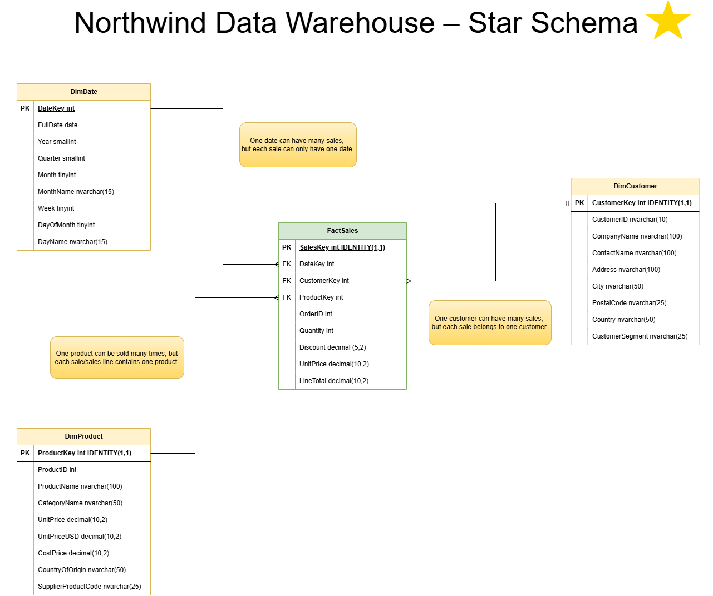
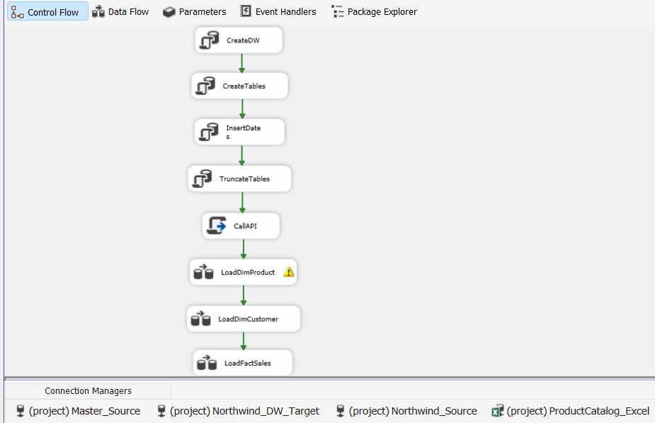
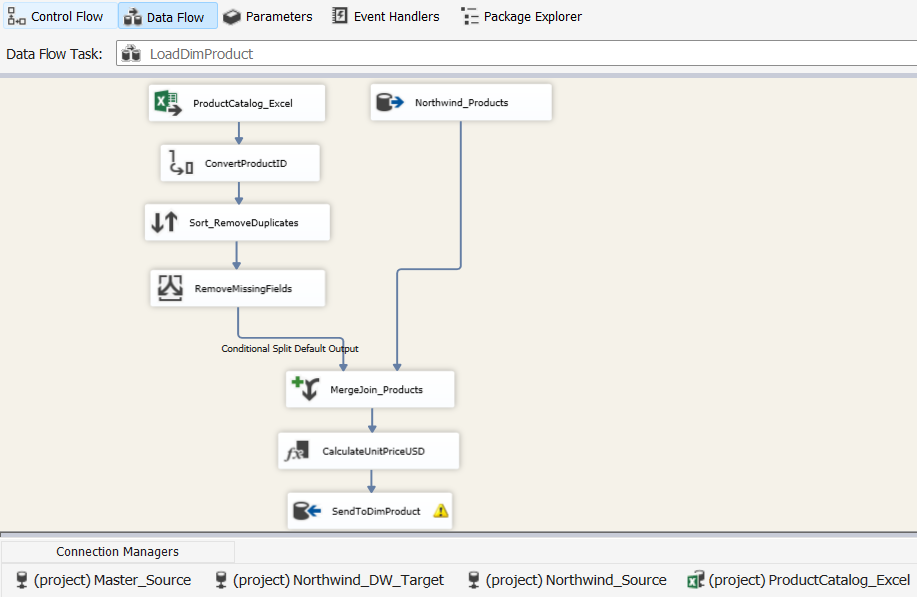
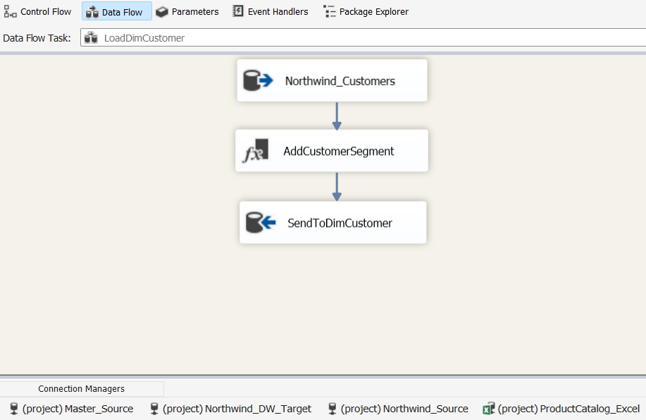
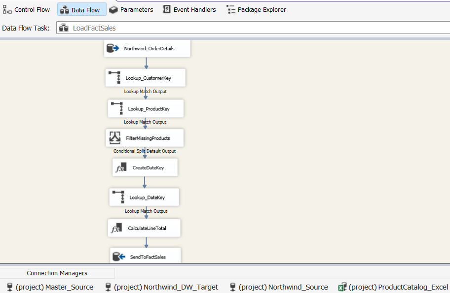
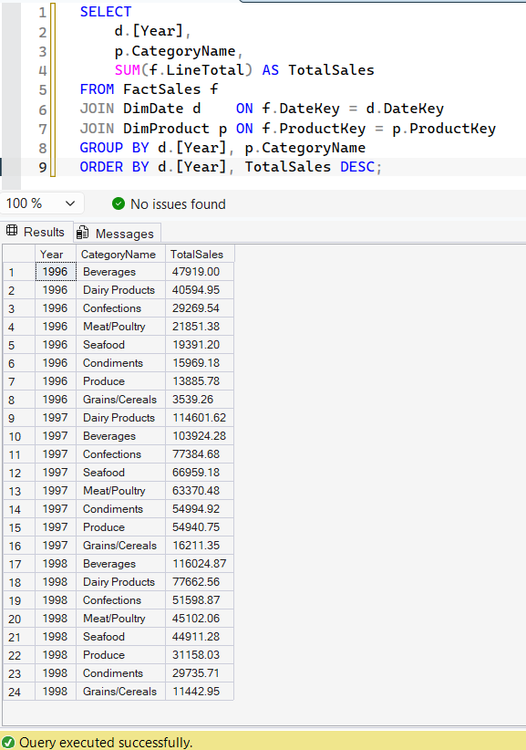

# Northwind Data Warehouse – ETL Pipeline in SSIS
An ETL pipeline that builds a star-schema data warehouse for the fictional e-commerce company Northwind. Data is extracted from three different source types, cleaned and transformed in SSIS, and loaded into SQL Server.

## Data warehouse model

A star schema with one fact table and three dimensions:

| Table | Description |
|---|---|
| `FactSales` | One row per order line: quantity, discount, unit price and line total |
| `DimProduct` | Products enriched with cost price, country of origin and USD price |
| `DimCustomer` | Customers with a derived customer segment (Americas / Europe) |
| `DimDate` | Date dimension generated for 1985–2030 |

## Data sources

- **Northwind database (SQL Server)** – customers, products, categories and orders
- **Excel product catalog** – cost price, country of origin and supplier product code
- **Exchange rate API** ([open.er-api.com](https://open.er-api.com)) – current SEK to USD rate, fetched with a C# Script Task

## ETL flow

1. **CreateDW / CreateTables** – creates the database and tables if they don't exist
2. **InsertDates** – populates the date dimension
3. **TruncateTables** – clears tables before a full reload
4. **CallAPI** – fetches the exchange rate and stores it in a package variable
5. **LoadDimProduct** – merges Northwind products with the Excel catalog
6. **LoadDimCustomer** – loads customers and assigns a segment
7. **LoadFactSales** – loads order lines with surrogate keys from the dimensions

### LoadDimProduct

Excel data is cleaned before it is merged with the Northwind products:
- `ProductID` converted from float to integer
- Duplicates removed with a sort
- Rows with missing cost price, country or supplier code filtered out
- `UnitPriceUSD` calculated using the exchange rate from the API

### LoadDimCustomer

Customers are assigned a `CustomerSegment` based on country.

### LoadFactSales

Each order line is matched to `CustomerKey`, `ProductKey` and `DateKey` through lookups. Order lines with no matching product are filtered out, and `LineTotal` is calculated as `Quantity × UnitPrice × (1 − Discount)`.

## Result

Sales per product category and year, queried from the finished data warehouse.

## Tech stack

- T-SQL
- SQL Server Integration Services (SSIS) in Visual Studio
- C# (Script Task for the API call)
- draw.io for data modeling

## How to run

1. Restore the Northwind sample database in SQL Server
2. Open `Eddie_Mellstrom_ETL.slnx` in Visual Studio with the SSIS extension
3. Update the connection managers to point to your SQL Server instance and the location of `ProductCatalog_Extra.xlsx`
4. Run `Package.dtsx` – the data warehouse is created automatically

## What I learned

- How a star schema works, with a fact table in the middle and dimension tables around it
- How messy data from Excel needs to be cleaned before it can be used
- How to get data from an API and use it in an ETL pipeline

